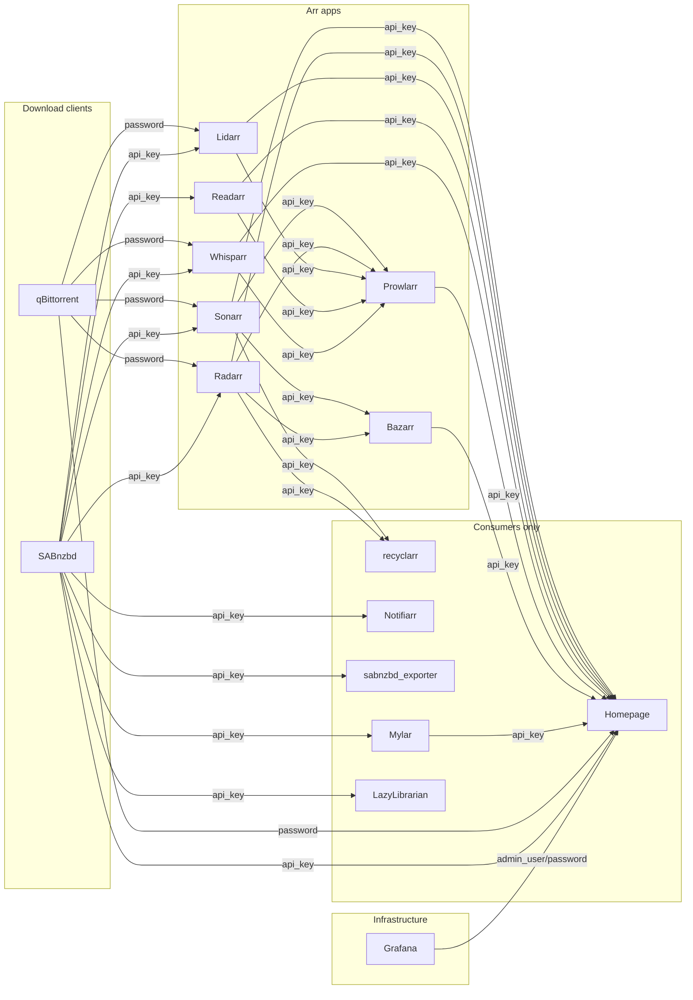

# Credential Dependencies

This document maps how credentials flow between services in the arr media stack. It answers:
which service produces a credential, which services consume it, where each credential is
stored, and in what format. Use this as a reference when rotating credentials manually or
with the rotation scripts.

## Credential flow graph

Each arrow is labelled with the credential type. Nodes are grouped by role: **arr apps**
(blue), **support services** (green), **infrastructure** (orange), **consumers only** (grey).



## Credential flow matrix

Rows are producers. Columns are consumers. A cell contains the credential type that the
producer exposes and the consumer uses.

```text
Producer \ Consumer  | Prowlarr | Bazarr | recyclarr | Sonarr | Radarr | Lidarr | Readarr | Whisparr | Mylar | LazyLibrarian | Notifiarr | Exporter | Homepage
---------------------|----------|--------|-----------|--------|--------|--------|---------|----------|-------|---------------|-----------|----------|---------
Sonarr               | api_key  | api_key| api_key   |        |        |        |         |          |       |               |           |          | api_key
Radarr               | api_key  | api_key| api_key   |        |        |        |         |          |       |               |           |          | api_key
Lidarr               | api_key  |        |           |        |        |        |         |          |       |               |           |          | api_key
Readarr              | api_key  |        |           |        |        |        |         |          |       |               |           |          | api_key
Whisparr             | api_key  |        |           |        |        |        |         |          |       |               |           |          | api_key
Prowlarr             |          |        |           |        |        |        |         |          |       |               |           |          | api_key
Bazarr               |          |        |           |        |        |        |         |          |       |               |           |          | api_key
Mylar                |          |        |           |        |        |        |         |          |       |               |           |          | api_key
qBittorrent          |          |        |           | password| password| password|         | password |       |               |           |          | password
SABnzbd              |          |        |           | api_key | api_key | api_key | api_key | api_key  | api_key/password | api_key/password | api_key | api_key | api_key
Grafana              |          |        |           |         |         |         |         |          |       |               |           |          | admin_user/password
```

## Per-service credential detail

**Sonarr**

- Produces: API key (see `configs/sonarr/config/config.xml` `<ApiKey>`)
- Consumed by: Prowlarr (Applications table, id=3), Bazarr (config.yaml `sonarr.apikey`),
  recyclarr (secrets.yml `sonarr_apikey`), Homepage (`HOMEPAGE_FILE_SONARR_API_KEY`)
- Consumes: qBittorrent password and SABnzbd API key/password (stored in DownloadClients
  table of sonarr.db)

**Radarr**

- Produces: API key (see `configs/radarr/config/config.xml` `<ApiKey>`)
- Consumed by: Prowlarr (Applications table, id=5), Bazarr (config.yaml `radarr.apikey`),
  recyclarr (secrets.yml `radarr_apikey`), Homepage (`HOMEPAGE_FILE_RADARR_API_KEY`)
- Consumes: qBittorrent password and SABnzbd API key/password (stored in DownloadClients
  table of radarr.db)

**Lidarr**

- Produces: API key (see `configs/lidarr/config/config.xml` `<ApiKey>`)
- Consumed by: Prowlarr (Applications table, id=1), Homepage (`HOMEPAGE_FILE_LIDARR_API_KEY`)
- Consumes: qBittorrent password and SABnzbd API key/password (stored in DownloadClients
  table of lidarr.db)

**Readarr**

- Produces: API key (see `configs/readarr/config/config.xml` `<ApiKey>`)
- Consumed by: Prowlarr (Applications table, id=2), Homepage (`HOMEPAGE_FILE_READARR_API_KEY`)
- Consumes: qBittorrent password and SABnzbd API key/password (stored in DownloadClients
  table of readarr.db)

**Whisparr**

- Produces: API key (see `configs/whisparr/config/config.xml` `<ApiKey>`)
- Consumed by: Prowlarr (Applications table, id=7), Homepage (`HOMEPAGE_FILE_WHISPARR_API_KEY`)
- Consumes: qBittorrent password and SABnzbd API key/password (stored in DownloadClients
  table of whisparr3.db)

**Prowlarr**

- Produces: API key (see `configs/prowlarr/config/config.xml` `<ApiKey>`)
- Consumed by: Homepage (compose secret, `configs/prowlarr/secrets/api_key.txt`)
- Consumes: API keys of Sonarr, Radarr, Lidarr, Readarr, Whisparr (Applications table,
  Settings JSON field `apiKey`)

**Bazarr**

- Produces: API key (see `configs/bazarr/config/config/config.yaml` `auth.apikey`)
- Consumed by: Homepage (compose secret, `configs/bazarr/secrets/api_key.txt`)
- Consumes: Sonarr API key (config.yaml `sonarr.apikey`), Radarr API key (config.yaml
  `radarr.apikey`)

**qBittorrent**

- Produces: WebUI password (username `qbittorrent`, see DownloadClients table in any arr
  DB for current value)
- Consumed by: Sonarr, Radarr, Lidarr, Whisparr (each app's DownloadClients table). Not
  Readarr, whose client has no credentials: qBittorrent lets `READARR_SERVICES_IP` in
  without a login (see [CONNECTIONS.md](CONNECTIONS.md))
- Consumes: nothing from other services

**SABnzbd**

- Produces: API key, NZB key, and WebUI password (username `sabnzbd`, see
  `configs/sabnzbd/config/sabnzbd.ini`)
- Consumed by: Sonarr, Radarr, Lidarr, Readarr, Whisparr, Mylar, LazyLibrarian, Notifiarr,
  and `sabnzbd_exporter`
- Consumes: shared TLS certificate files from `certs/`

**Grafana**

- Produces: admin username/password (see `configs/grafana/config/grafana.ini` `[security]`)
- Consumed by: Homepage (`HOMEPAGE_FILE_GRAFANA_AUTH`) for the built-in Grafana widget
- Note: the Homepage Grafana widget calls `/api/admin/stats`, which requires Grafana
  server-admin access; a Grafana service account token is not sufficient for this endpoint.

## Credential storage locations

| Service       | Credential                | File path                                                             | Format                                                    |
|---------------|---------------------------|-----------------------------------------------------------------------|-----------------------------------------------------------|
| Sonarr        | API key                   | `configs/sonarr/config/config.xml` (`<ApiKey>`)                       | plain text XML element                                    |
| Radarr        | API key                   | `configs/radarr/config/config.xml` (`<ApiKey>`)                       | plain text XML element                                    |
| Lidarr        | API key                   | `configs/lidarr/config/config.xml` (`<ApiKey>`)                       | plain text XML element                                    |
| Readarr       | API key                   | `configs/readarr/config/config.xml` (`<ApiKey>`)                      | plain text XML element                                    |
| Whisparr      | API key                   | `configs/whisparr/config/config.xml` (`<ApiKey>`)                     | plain text XML element                                    |
| Prowlarr      | API key                   | `configs/prowlarr/config/config.xml` (`<ApiKey>`)                     | plain text XML element                                    |
| Prowlarr      | app API keys              | `configs/prowlarr/config/prowlarr.db` (Applications table)            | plain text JSON in Settings                               |
| Bazarr        | API key                   | `configs/bazarr/config/config/config.yaml` (`auth.apikey`)            | plain text YAML value                                     |
| Bazarr        | login password            | `configs/bazarr/config/config/config.yaml` (`auth.password`)          | MD5 hash                                                  |
| Bazarr        | sonarr API key            | `configs/bazarr/config/config/config.yaml` (`sonarr.apikey`)          | plain text YAML value                                     |
| Bazarr        | radarr API key            | `configs/bazarr/config/config/config.yaml` (`radarr.apikey`)          | plain text YAML value                                     |
| recyclarr     | sonarr API key            | `configs/recyclarr/config/secrets.yml` (`sonarr_apikey`)              | plain text YAML value                                     |
| recyclarr     | radarr API key            | `configs/recyclarr/config/secrets.yml` (`radarr_apikey`)              | plain text YAML value                                     |
| Sonarr        | login password            | `configs/sonarr/config/sonarr.db` (Users table)                       | PBKDF2-SHA512 hash                                        |
| Radarr        | login password            | `configs/radarr/config/radarr.db` (Users table)                       | PBKDF2-SHA512 hash                                        |
| Lidarr        | login password            | `configs/lidarr/config/lidarr.db` (Users table)                       | PBKDF2-SHA512 hash                                        |
| Readarr       | login password            | `configs/readarr/config/readarr.db` (Users table)                     | PBKDF2-SHA512 hash                                        |
| Whisparr      | login password            | `configs/whisparr/config/whisparr.db` (Users table)                   | PBKDF2-SHA512 hash                                        |
| Prowlarr      | login password            | `configs/prowlarr/config/prowlarr.db` (Users table)                   | PBKDF2-SHA512 hash                                        |
| qBittorrent   | WebUI password            | `configs/qbittorrent/config/qBittorrent/qBittorrent.conf`             | PBKDF2 hash in WebUI section                              |
| SABnzbd       | API key                   | `configs/sabnzbd/config/sabnzbd.ini` (`misc.api_key`)                 | plain text INI value                                      |
| SABnzbd       | NZB key                   | `configs/sabnzbd/config/sabnzbd.ini` (`misc.nzb_key`)                 | plain text INI value                                      |
| SABnzbd       | login password            | `configs/sabnzbd/config/sabnzbd.ini` (`misc.password`)                | plain text INI value                                      |
| SABnzbd       | exporter API key          | compose secret, `configs/sabnzbd/secrets/api_key.txt`                 | mounted file, `FILE__SABNZBD_APIKEYS` shim                |
| Mylar         | SABnzbd creds             | `configs/mylar/config/mylar/config.ini` (`[SABnzbd]`)                 | plain text INI values                                     |
| LazyLibrarian | SABnzbd creds             | `configs/lazylibrarian/config/config.ini` (`[SABNZBD]`)               | plain text INI values                                     |
| Notifiarr     | SABnzbd API key           | `configs/notifiarr/config/notifiarr.conf` (`[[sabnzbd]]`)             | plain text TOML value                                     |
| Sonarr        | qbt password              | `configs/sonarr/config/sonarr.db` (DownloadClients table)             | plain text JSON in Settings                               |
| Radarr        | qbt password              | `configs/radarr/config/radarr.db` (DownloadClients table)             | plain text JSON in Settings                               |
| Lidarr        | qbt password              | `configs/lidarr/config/lidarr.db` (DownloadClients table)             | plain text JSON in Settings                               |
| Whisparr      | qbt password              | `configs/whisparr/config/whisparr3.db` (DownloadClients table)        | plain text JSON in Settings                               |
| Sonarr        | SABnzbd API key/password  | `configs/sonarr/config/sonarr.db` (DownloadClients table)             | plain text JSON in Settings                               |
| Radarr        | SABnzbd API key/password  | `configs/radarr/config/radarr.db` (DownloadClients table)             | plain text JSON in Settings                               |
| Lidarr        | SABnzbd API key/password  | `configs/lidarr/config/lidarr.db` (DownloadClients table)             | plain text JSON in Settings                               |
| Readarr       | SABnzbd API key/password  | `configs/readarr/config/readarr.db` (DownloadClients table)           | plain text JSON in Settings                               |
| Whisparr      | SABnzbd API key/password  | `configs/whisparr/config/whisparr3.db` (DownloadClients table)        | plain text JSON in Settings                               |
| Homepage      | Sonarr API key            | compose secret, `configs/sonarr/secrets/api_key.txt`                  | mounted file, `HOMEPAGE_FILE_SONARR_API_KEY`              |
| Homepage      | Radarr API key            | compose secret, `configs/radarr/secrets/api_key.txt`                  | mounted file, `HOMEPAGE_FILE_RADARR_API_KEY`              |
| Homepage      | Lidarr API key            | compose secret, `configs/lidarr/secrets/api_key.txt`                  | mounted file, `HOMEPAGE_FILE_LIDARR_API_KEY`              |
| Homepage      | Readarr API key           | compose secret, `configs/readarr/secrets/api_key.txt`                 | mounted file, `HOMEPAGE_FILE_READARR_API_KEY`             |
| Homepage      | Whisparr API key          | compose secret, `configs/whisparr/secrets/api_key.txt`                | mounted file, `HOMEPAGE_FILE_WHISPARR_API_KEY`            |
| Homepage      | Prowlarr API key          | compose secret, `configs/prowlarr/secrets/api_key.txt`                | mounted file, `HOMEPAGE_FILE_PROWLARR_API_KEY`            |
| Homepage      | Bazarr API key            | compose secret, `configs/bazarr/secrets/api_key.txt`                  | mounted file, `HOMEPAGE_FILE_BAZARR_API_KEY`              |
| Homepage      | Mylar API key             | compose secret, `configs/mylar/secrets/api_key.txt`                   | mounted file, `HOMEPAGE_FILE_MYLAR_API_KEY`               |
| Homepage      | SABnzbd API key           | compose secret, `configs/sabnzbd/secrets/api_key.txt`                 | mounted file, `HOMEPAGE_FILE_SABNZBD_API_KEY`             |
| Homepage      | qBittorrent user/password | compose secret, `configs/qbittorrent/secrets/{username,password}.txt` | mounted files, `HOMEPAGE_FILE_QBITTORRENT_USER/PASS`      |
| Homepage      | Jellyfin API key          | compose secret, `configs/jellyfin/secrets/api_key.txt`                | mounted file, created in Jellyfin Dashboard               |
| Homepage      | Audiobookshelf token      | compose secret, `configs/audiobookshelf/secrets/api_key.txt`          | mounted file, JWT from `absdatabase.sqlite` `users.token` |
| Homepage      | Calibre-Web user/password | compose secret, `configs/calibre-web/secrets/{username,password}.txt` | mounted files, `HOMEPAGE_FILE_CALIBREWEB_USER/PASS`       |
| Grafana       | admin username            | `configs/grafana/config/grafana.ini` (`admin_user`)                   | plain text INI value                                      |
| Grafana       | admin password            | `configs/grafana/config/grafana.ini` (`admin_password`)               | plain text INI value                                      |
| Homepage      | Grafana Basic auth header | compose secret, `configs/grafana/secrets/homepage_auth.txt`           | mounted file, `HOMEPAGE_FILE_GRAFANA_AUTH`                |

**Homepage** reads every credential in the rows above from a file mounted via
compose `secrets:`, never from its own `.env`/`.env.secrets`; the
`HOMEPAGE_FILE_*` names are the variables it substitutes those mounted paths
into (see `docs/COMPOSE_CONVENTIONS.md`). `rotate-api-keys.sh` and
`rotate-passwords.sh` write the owning service's secret file directly for
every credential they rotate, including Jellyfin, Grafana, and Calibre-Web.
Only the Audiobookshelf token remains manual: it is a per-user JWT issued by
Audiobookshelf itself.

**Note:** The `<SslCertPassword>` field present in each arr `config.xml` is managed
exclusively by `make generate_certificate` and `scripts/rotate-certificate.sh`. The API
key and password rotation scripts must not touch it.

---

See also: [README.md](../README.md), [docs/MAKE_COMMANDS.md](MAKE_COMMANDS.md)
